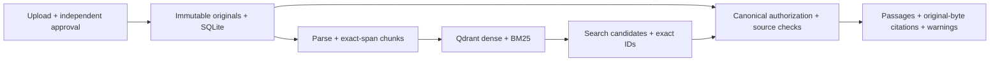

# Palladion

**An evidence-first agent harness for answers that can be checked.**

Palladion investigates how an agent can keep claims attached to authoritative evidence,
recognize when evidence is insufficient, preserve case context, and challenge its own
conclusions before release. The initial research domain is support investigation using
fictional payment documents and read-only mock operational systems.

The project is being built system-first, without a UI. Its research claims remain
hypotheses until tested against controlled baselines and held-out cases.

**Current state:** P01 is verified; P02 provenance retrieval is verified complete: strict
contracts, persisted synthetic access/approval, SQLite/originals and 24 pilot fixtures.
The uv package/lock and offline validation entry point exist. Message API,
agent loop, UI and full answer-system benchmark results remain absent.
P02 includes real dense/BM25 Qdrant retrieval, source/search/citation API and retrieval-only
pilots. Use the Docker-free WSL launcher documented in palladion/README.md.
The future generative boundary uses Groq `qwen/qwen3.8-27b`; current retrieval needs no
Groq API call. P03 remains future scope.

## What works today

- Typed contracts, persisted identities, tenant/case membership and source ACLs.
- Immutable originals, independent upload/approval actors and source revocation.
- Exact-span chunks and a SQLite catalog that publishes generations after exact index readback.
- Real Qdrant dense/BM25 search, native RRF and an independent exact-identifier path.
- Canonical evidence checks, bounded optional reranking and context expansion.
- Authenticated local upload, approval, search, citation and index-coverage endpoints.
- Retrieval-only pilot reports with representation identities, raw ranks and failure accounting.

Search results are discovery candidates. Before returning text, Palladion rechecks stored
identity, scope, approval, applicability, generation and original bytes. Search scores and
model output do not give a source authority.



Later phases add temporal policy execution, bounded read tools and an agent loop,
independent-context criticism, continuity memory and a final release gate. Enterprise
identity integration, generated answers, graph traversal and full answer-system benchmarks
are not implemented by the current retrieval prototype.

## Run and explore

Start with the [application setup guide](palladion/README.md) for uv, the Docker-free
Qdrant launcher, synthetic seeding, API routes and validation commands.

```powershell
cd palladion
uv sync --locked
uv run --locked --no-env-file python scripts/validate_foundation.py
uv run --locked --no-env-file python scripts/check_dependencies.py --self-test
```

These checks need no provider credentials. Retrieval additionally requires local Qdrant
and initially downloads pinned local model assets. Windows verification uses WSL Ubuntu
with Linux-owned storage; x86_64 Linux can run the standalone launcher directly.

## Documentation and repository

- [Documentation entry point](palladion/docs/README.md)
- [Master vision](palladion/docs/vision/palladion-blueprint-v2.md)
- [Master development plan](palladion/docs/development/MASTER_DEV_PLAN.md)
- [Current progress and next task](palladion/docs/development/PROGRESS.md)
- [Project instructions](AGENTS.md)

`palladion/` owns the system. `baseline/` is reserved for later comparisons with standard
RAG, LangChain RAG, and provider systems. The immediate priority is system behavior and
falsifiable hypothesis testing. UI development is excluded.

Documentation validation (Python standard library only, from repository root):

```powershell
python palladion/docs/development/check_docs.py
python palladion/docs/development/check_docs.py --self-test
```

These commands validate the documentation's structure and references, not system behavior.

| Path | Purpose |
|---|---|
| `palladion/src/evidence_agent/` | Implemented system modules |
| `palladion/scripts/` | Setup, validation, reconciliation and measurement entry points |
| `palladion/tests/` | Contracts, authorization, ingestion and real retrieval consumers |
| `palladion/data/demo/` | Fictional sources and pilot fixtures |
| `palladion/docs/development/` | Atomic plan, ADRs, gates, evidence and current status |

## Verification and research limits

The latest P02 suite passed 117 real-server-enabled tests, strict typing, lint, build and an
isolated installed-wheel HTTP smoke. The dependency/completion audit and its
results are recorded in the [evidence log](palladion/docs/development/EVIDENCE_LOG.md).
Tests without explicit real-server enablement skip integration cases.

The current pilot has eight synthetic queries over a tiny corpus and lacks independently
adjudicated labels. English/Indonesian query coverage does not establish general multilingual
quality. Retrieval metrics do not establish answer correctness, production readiness or
superiority. External comparator implementations and full answer-system experiments remain
future work. Phase 3 awaits explicit GO.
