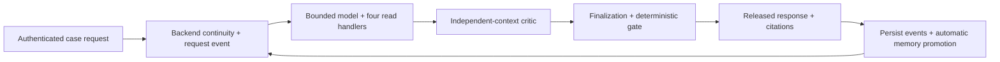
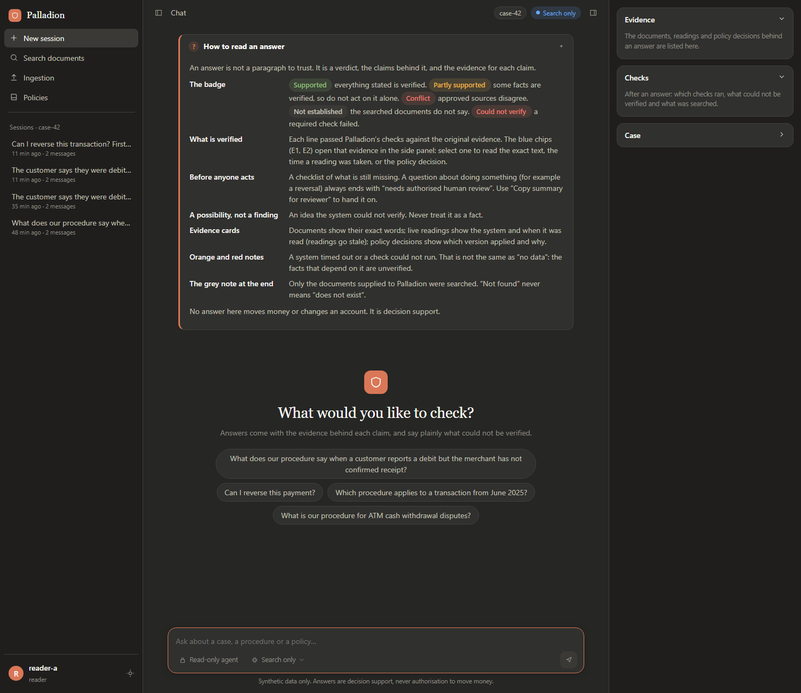
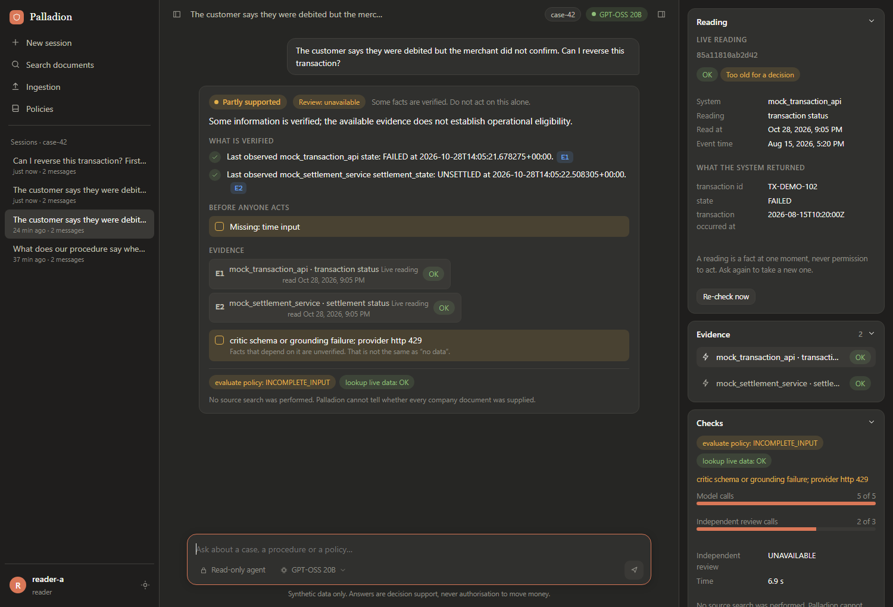
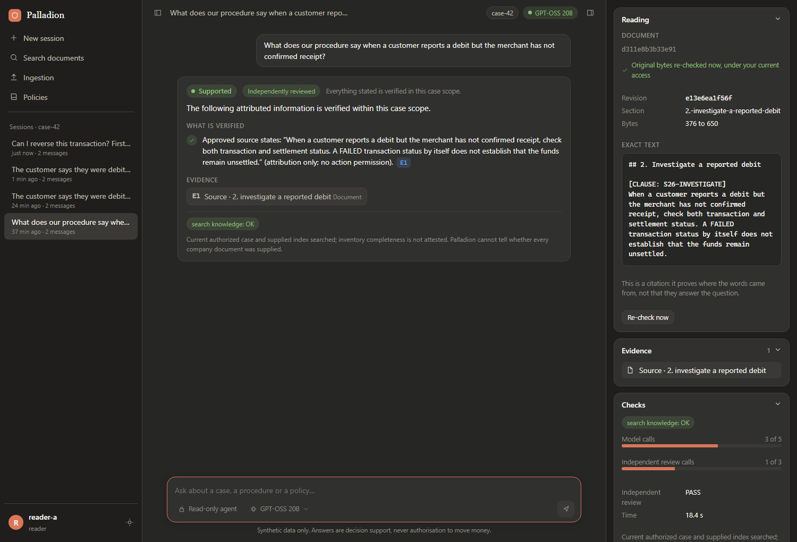
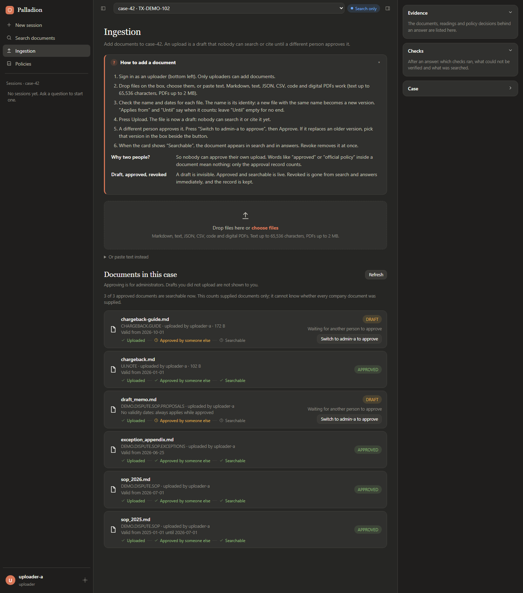
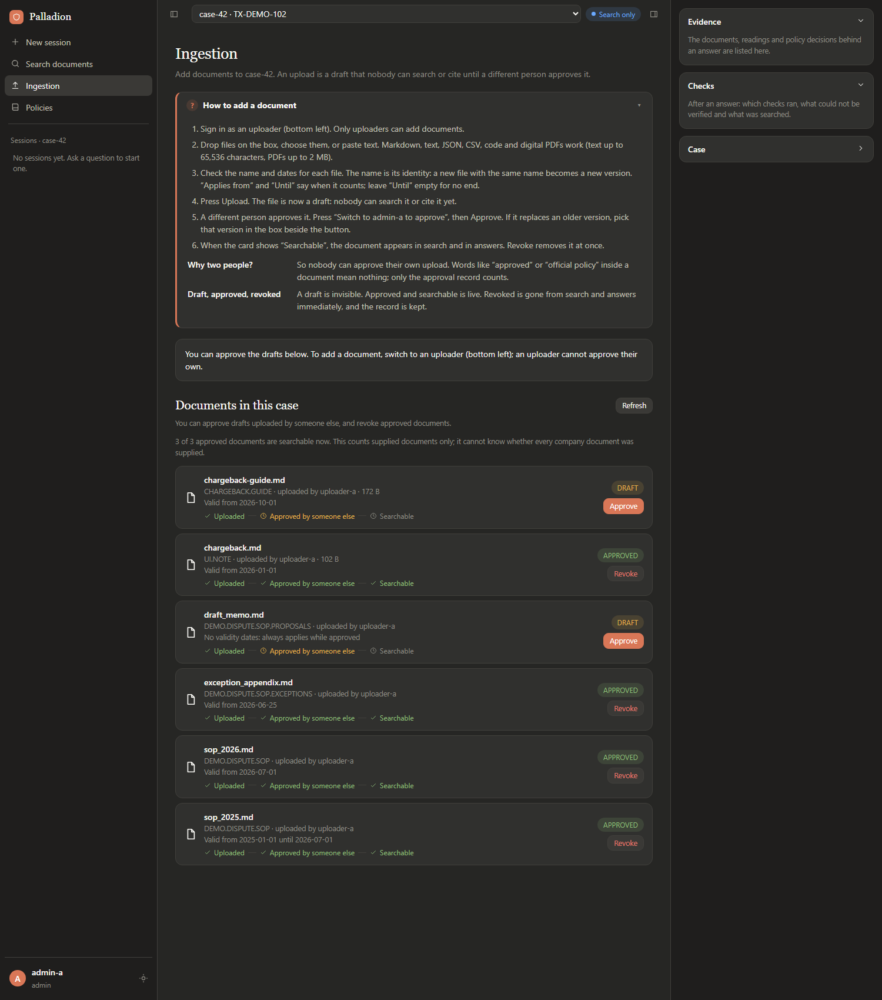
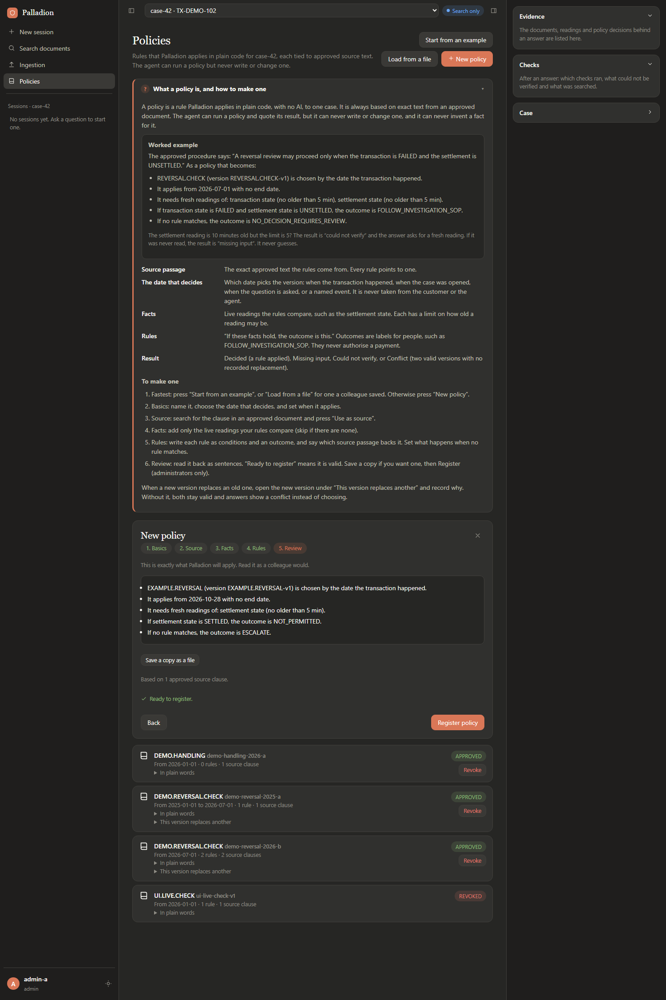
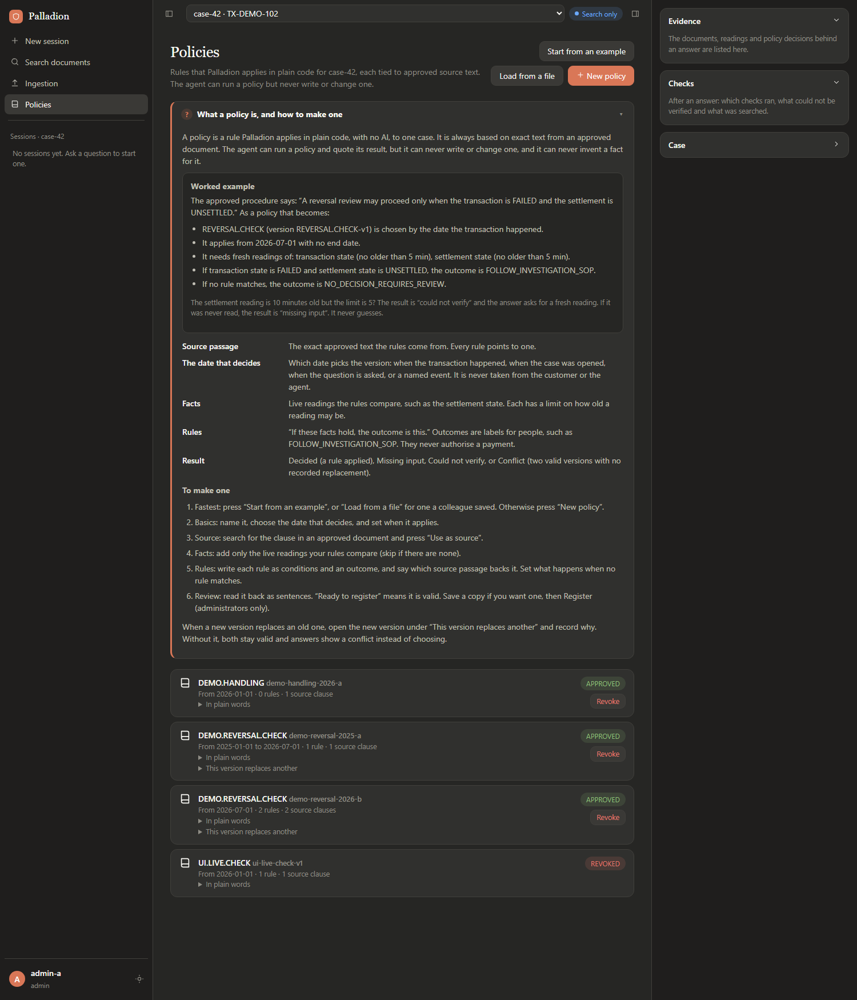
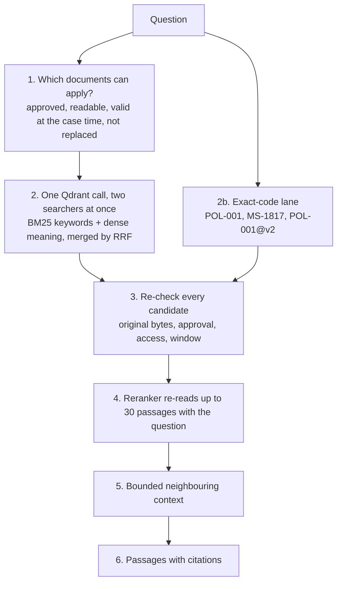
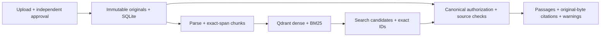

# Palladion

**An evidence-first agent harness for answers that can be checked.**

Palladion investigates how an agent can keep claims attached to authoritative evidence,
recognize when evidence is insufficient, preserve case context, and challenge its own
conclusions before release. The initial research domain is support investigation using
fictional payment documents and read-only mock operational systems.

The system was built first, without a UI; [`palladion-ui/`](palladion-ui/README.md) is now a thin local client on top of its
HTTP API. Its research claims remain hypotheses until tested against controlled baselines and held-out cases.

**Current state:** P01–P03 are verified. P04's bounded runtime, four read tools, claim
gate, messages/citations, scoped developer traces/readiness and cancellable search worker
are verified through actual provider/HTTP/wheel checks and independent end-review
resolution. P04/P05 are published; scoped memory/continuity is verified complete. P06 independent critic, bounded counter-search and final gate are verified with installed/live checks and end-review resolution. Its paired synthetic experiment remains neutral for full exception correction. No UI or research-hypothesis success is claimed. All passing and failed model
checks and current gates are recorded in [progress](palladion/docs/development/PROGRESS.md).
P07 is complete within its engineering scope: opt-in source graph, backend sessions and
automatic memory promotion passed actual consumer checks and independent review. The
paired graph pilot found no incremental exception recovery; graph stays disabled by default.
P08's engineering pilot is complete: 44 observations across 11 arms, including 16
row-level errors. All 24 integrity controls pass on the supplied tests, and the
independent review is resolved. The pilot does not establish the hypothesis or
independently adjudicated semantic accuracy. Unobserved higher-stage retrieval metrics
are explicitly unavailable in the [results](palladion/docs/development/evidence/P08_RESULTS.md).
Retrieval uses real dense/BM25 Qdrant; the Docker-free WSL launcher is documented in the
[application README](palladion/README.md). Generative commands explicitly enable Groq
Qwen3.8-27B, GPT-OSS120B or GPT-OSS20B; retrieval-only checks need no provider call.

## How Palladion differs from a normal RAG system

A normal RAG system retrieves the passages most similar to a question and asks a language model to write the answer.
Retrieval is a *relevance* problem, and the model decides what is true. Palladion treats the model as an untrusted
component: it may investigate, but approved sources, deterministic rules and re-checked evidence decide what can be
claimed.

| | Normal RAG | Palladion |
|---|---|---|
| Question it answers | What text is relevant? | What may be claimed, and what is the evidence? |
| After retrieval | Passages go straight into the prompt | Every candidate is re-checked against the catalog and the original bytes: approval, validity window, replacement, access list, index generation ([architecture §8](architecture.md#8-what-re-checking-a-candidate-means)) |
| Which version of a policy applies | Whichever chunk scores highest | Chosen by deterministic code from a time the policy declares; two valid versions with no recorded precedence give `POLICY_CONFLICT`, never a guess |
| Other evidence | Documents only | Documents, deterministic policy decisions, timestamped read-only observations, case events |
| A citation | An ID the model attaches | A handle that reads the exact span back under current access and approval |
| "I cannot tell" | Rare | A first-class outcome that names the missing requirement |
| Self-check | None | An independent-context critic, then a deterministic gate that re-reads every cited item |
| Text inside a document or message | May be followed | Evidence to assess, never an instruction |

The price is complexity and latency. The [benchmark](report.md) measures part of the benefit (finding the right,
current, permitted document) and none of the answer-level benefit yet. Whole sessions, step by step, are in
[architecture.md §9](architecture.md#9-worked-examples).

## How Palladion compares today (plain-language scorecard)

The [benchmark](palladion-benchmark/README.md) tests how well Palladion's search finds the documents a question
needs, next to common alternatives. The result below is from a **sealed run on six new fictional worlds** (600
questions, 446 of which test finding documents; each world has 1,200 documents). Before the run, every system was
tuned the same amount on separate development worlds, the way of judging was written down, and the questions were
not looked at one by one. It tests **finding documents only** (not answering), on **invented data**, with answer
labels made by the benchmark's generator that no human has checked.

| System | Questions where **all** needed documents were found | Share of needed documents found |
|---|---|---|
| **Palladion's retriever** | **39.9%** | **49.5%** |
| Strong baseline plus Palladion's approval-and-date rule | 26.9% | 33.2% |
| Keyword + meaning | 24.7% | 29.4% |
| Strong common baseline (keyword + meaning + re-reader) | 22.6% | 28.4% |
| Keyword + exact-code rule | 22.4% | 29.9% |
| Keyword search | 22.2% | 29.7% |
| Meaning search | 13.2% | 19.2% |

In words:

* **The check written down beforehand passed.** Palladion minus the strong baseline is +17 percentage points
  (range +12 to +23), above the 5-point bar fixed before the run. Against the baseline that also gets Palladion's
  approval-and-date rule it is still +13 points (range +7 to +19), so the rule explains about a quarter of the lead
  and the rest of Palladion's design the rest.
* **The earlier, bigger lead was partly an artefact.** On the first 72 questions Palladion looked +22 points ahead
  of the strong baseline. That run had weak baselines (their text pieces were too small) and Palladion had been
  improved on those very questions. With every baseline tuned and new questions, the lead is about +17.
* **Where Palladion helps most:** exact codes and rule numbers (every one found, against two thirds for keyword
  search) and questions that need several documents (37%, against 3% or less for the others).
* **Where it does not:** "which version" questions (20%, against 45% for the baseline with the approval-and-date
  rule) and conflicting sources (52%, against 62%). **No system finds** the who-may-see-what or the broad-summary
  questions.
* **Fewer wrong kinds of document:** Palladion returns an out-of-date version in 0.3% of questions (the others 8%
  to 10%, except the baseline with its rule at 0.5%), a document of unclear authority in 0% (others 10% to 15%),
  and no system showed a document the person may not see.
* **Repeatable?** Rebuilding Palladion from scratch gave the same ten documents in the same order for 92% to 95% of
  questions; the other systems gave exactly the same lists every time.
* **Answering** (separate test, older Palladion version): almost no system answered a question completely right,
  and the answering model, not only the search, limits the result. Re-run in progress (see the report).

The full plain-language report, with every test, the history of the improvements and what is still to do, is in
[report.md](report.md).

## Core terms

| Term | Meaning in Palladion |
|---|---|
| **Tenant / principal** | A tenant is an isolation boundary; a principal is a persisted authenticated user with current roles and grants. A principal ID in request text grants no access. |
| **Case** | An authorized investigation workspace connecting approved sources, operational targets, policy decisions and audit history. Membership is checked again when data is read. |
| **Session** | One user's explicit conversation within a case, with start/end lifecycle. A case can outlive many sessions; episodic memory is session-bound. |
| **Document / revision** | Supplied source material and its immutable content-addressed version. Upload produces a draft; a separate authorized actor approves it. Wording such as “approved” inside the source has no authority. |
| **Chunk / citation** | A bounded exact text span and a reference that can read that span back under current access, approval, applicability and generation checks. A citation establishes provenance, not semantic entailment by itself. |
| **Generation** | A particular parsed/embedded index publication. It becomes ready only after expected IDs, hashes and representation identities match physical readback. |
| **Policy** | An externally approved, source-linked deterministic rule table with applicability and trusted time/input requirements. The model cannot invent a policy winner. |
| **Live observation** | The timestamped result of an allowlisted operational read. This prototype uses fictional mock systems; “live” describes the tool boundary, not a production database connection. |
| **Memory** | Persisted unverified context with provenance, scope and validity controls. Semantic memory holds private user preferences across sessions; episodic memory belongs to one session; procedural memory records unapproved tool/workflow experience. None becomes company policy automatically. |
| **Continuity packet** | Backend-built bounded context for the next request: current goal, gaps, rechecked handles, memory and own-session conversation turns. It is untrusted context, not new evidence authority. |
| **Critic / gate** | The critic challenges a draft in a separate model context. The deterministic gate decides which claims may be released under canonical checks. Model agreement is not independent truth. |
| **Graph** | Optional source-proven navigation between chunks/entities. Relations help discover sources; they cannot authorize an answer or override policy precedence. |
| **Disposition** | The outcome class of a released answer: `SUPPORTED`, `PARTIALLY_SUPPORTED`, `CONFLICT`, `NOT_ESTABLISHED` or `VERIFICATION_UNAVAILABLE`. Chosen by the gate, never by the model. |
| **Request ledger** | The evidence handles one request holds (at most 32, of which at most 12 document passages). Every release re-reads each handle's original authority. |

## From a question to an answer

The backend authenticates the caller and case, builds continuity without a model call,
and persists the current request. The model may request one of four read tools:
`search_knowledge`, `lookup_live_data`, `evaluate_policy` or `recall_memory`. Backend
handlers validate each request, enforce scope and budgets, and return typed results.
The independent-context critic challenges the draft before finalization. The gate
then rechecks canonical evidence and releases qualified claims or an honest lack of
verification. The backend persists the released response and automatically classifies
eligible event chunks for future memory.



Document ingestion is a separate flow: upload → independent approval → parsing and
index publication → current authorized search/citation reads. It does not turn every
document into a user preference. Runtime memory promotion and continuity construction
are automatic in ordinary serving; the additional `recall_memory` tool is selected by
the model when useful. Explicit administrative corrections, wider sharing and optional
Path B embedding jobs remain controlled operations.

P10 adds weighted deterministic classification, bounded conversation context, typed
graph-link administration and extra text/PDF formats. Its current verification and
limitations are tracked in [P10 evidence](palladion/docs/development/evidence/P10_CLASSIFICATION_AND_FORMATS.md).

## What a released answer looks like

The message endpoint (`POST /v1/cases/{case_id}/messages`) returns a structured response, not free text. The wording of
each released claim comes from the gate, not from the model.

| Field | Meaning |
|---|---|
| `disposition` | One of the five outcome classes above |
| `answer` | One fixed sentence for the disposition |
| `verified_claims` | Claims that passed the gate, each with its evidence IDs |
| `hypotheses` | Unverified possibilities. The gate allows one fixed sentence, and only on informational answers |
| `missing_requirements` | Named gaps such as `settlement_state` or `authorized_human_review` |
| `citations` | The document spans, timestamped live observations and policy decisions behind the claims |
| `tool_status`, `verification_failures` | What each tool returned and what could not be verified |
| `searched_scope`, `inventory_attested` | What was searched; `inventory_attested` is always `false`, because Palladion cannot know that every company document was supplied |
| `review_status`, `budget`, `next_steps`, `session_id`, `trace_id` | Critic outcome, budgets used, a fixed next-step sentence, the session and the trace |

Operational guidance (for example "may I reverse this?") always carries `authorized_human_review` as a gap, so it is
never released as an unqualified go-ahead, and no tool can change a payment. A client therefore has to show
dispositions, claims with clickable evidence, gaps and observation times, not only text
([architecture §11](architecture.md#11-what-an-operators-screen-must-show)).

### What it looks like in the UI

Every screen opens with a short how-to guide (open the first time, then remembered): how to read an answer, how to add
a document, and what a policy is with a worked example. This is the chat one:



Two real answers from the [local UI](palladion-ui/README.md) (GPT-OSS 20B through Palladion, on the fictional `case-42`,
signed in as a reader). In the first, an operational question: the agent took live readings, the policy engine ran, and
the independent review was unavailable because Groq rate-limited that call. The UI shows all of it: a "Partly supported"
badge, the verified claims with clickable evidence (E1, E2), a checklist of what is missing, each reading with the time it
was taken, the failure named instead of hidden, and the side panel's live reading marked "Too old for a decision".



In the second, a procedure question: "Supported" and independently reviewed, with the exact source text re-read from the
original file in the side panel.



### Adding documents and policies in the UI

Both screens are built to be used without reading the docs. These captures are of the real Palladion with no model
(search-only mode), on the fictional `case-42`.

**Documents.** The guide at the top explains the steps. Drop files or paste text; each one becomes a draft that nobody can search or cite. The card shows the
three steps (uploaded, approved by someone else, searchable), and a draft waits for a *different* person: one click
switches to the approver. An administrator approves it, optionally saying which older version it replaces.





**Policies.** The guide explains what a policy is, with a worked example. A policy is built in five plain steps (basics, source passage, facts, rules, review). Nobody has to start
from a blank page: "Start from an example" fills in a policy from a real approved passage, "Load from a file" and "Save a
copy as a file" move policies between people, and the last step reads the policy back as sentences and validates it
before anything is registered.





Not shown in the answer screenshots: a conflict, a not-established answer or a hypothesis. Only a few real agent runs were possible before the
provider's rate limit (see [palladion-ui/docs/TESTING.md](palladion-ui/docs/TESTING.md)).

## Inside a search, and what "policy" means

The longer version, with every stage and file, is in [architecture.md](architecture.md). The short version:



* **BM25 and dense run at the same time**, not one after the other. BM25 matches the question's words (strong on exact
  codes), the dense model matches meaning (strong on paraphrase and Indonesian/English). Their two ranked lists are merged
  by reciprocal rank fusion. The **reranker comes after** the safety checks and only reorders what survived.
* **Search is not the policy engine.** Search finds documents and shows what they say. The **policy engine** is plain code
  (no language model) that applies an *approved rule table* to a case: it picks the policy version that applies at the
  time the table names, reads the live facts itself (the agent can only name which observations to use, never supply a
  value), checks they are fresh, runs the rules, and returns a decision with the matched rules and the source clauses
  (`DETERMINED`, `INCOMPLETE_INPUT`, `POLICY_CONFLICT`, ...). The agent calls search or `evaluate_policy` as the question
  needs; the final gate checks every released claim against the original evidence or the policy decision.
* A question may name a **version** (`POL-001@v2` means the second version of POL-001) and is then answered by that
  version even if a newer one replaced it. Without a version, only the version that applies at the case time is returned.

The policy tool, `evaluate_policy`, takes only two arguments: the policy `family_id` and the IDs of live observations
already read in this request. It has no argument for a fact value, a date or an action. It returns one status:

| Status | Meaning |
|---|---|
| `DETERMINED` | A rule was applied to verified, fresh inputs; the outcome and matched rules are in the decision |
| `INCOMPLETE_INPUT` | A required fact or time is missing |
| `UNVERIFIED_INPUT` | A fact or time source is stale, mistyped, not an allowed value or inconsistent |
| `VERIFICATION_UNAVAILABLE` | A required live read failed or timed out |
| `NO_APPLICABLE_POLICY` / `NOT_APPLICABLE` | No approved version fits the case's scope and time |
| `POLICY_CONFLICT` | Versions or rule outcomes that cannot be ordered, with no approved precedence |

Step by step, with the fixtures it is tested on: [architecture §4](architecture.md#4-the-policy-engine-and-how-it-differs-from-search).

## What works today

- Typed contracts, persisted identities, tenant/case membership and source ACLs.
- Immutable originals, independent upload/approval actors and source revocation.
- Exact-span chunks and a SQLite catalog that publishes generations after exact index readback.
- Real Qdrant dense/BM25 search, native RRF and an independent exact-identifier path.
- Canonical evidence checks, bounded optional reranking and context expansion.
- Authenticated local upload, approval, search, citation and index-coverage endpoints.
- Retrieval-only pilot reports with representation identities, raw ranks and failure accounting.
- Approved time-aware policy definitions, bounded predicate execution and persisted decision replay.
- Four named mock operational reads with target authorization, explicit errors, deadlines and freshness.
- Bounded real-Groq agent, four validated tool handlers and a deterministic claim gate.
- Authenticated messages, current citation readback, redacted timelines and scoped admin traces.
- Explicit dependency readiness, persisted failures and cancellable local search workers.
- Scoped memory, auditable owner/admin validity controls, FTS recall and bounded continuity packets.
- Independent advisory critique, bounded counter-search, review-aware finalization and canonical qualification of changed/unresolved proposals.

Search results are discovery candidates. Before returning text, Palladion rechecks stored
identity, scope, approval, applicability, generation and original bytes. Search scores and
model output do not give a source authority.



P04 implements the bounded agent loop, four read-tool handlers, generated drafts and
necessary-condition release gate. P05 adds scoped memory, owner-controlled validity,
FTS recall and revalidated continuity/cache. P06 implements independent-context
criticism, scoped counter-search and review-aware finalization/gating. P07 adds optional
graph navigation and deterministic memory categorization, with a separately enabled local
cosine supplement. P08 implements explicit experimental controls and replayable pilot
measurements; confirmatory research still requires independent adjudication. Enterprise identity integration
remains outside this synthetic prototype.

## Run and explore

Start with the [application setup guide](palladion/README.md) for uv, the Docker-free
Qdrant launcher, synthetic seeding, API routes and validation commands.

```powershell
cd palladion
uv sync --locked
uv run --locked --no-env-file python scripts/validate_foundation.py
uv run --locked --no-env-file python scripts/check_dependencies.py --self-test
uv run --locked --no-env-file python scripts/validate_policy.py
```

These checks need no provider credentials. Retrieval additionally requires local Qdrant
and initially downloads pinned local model assets. Windows verification uses WSL Ubuntu
with Linux-owned storage; x86_64 Linux can run the standalone launcher directly.

## Documentation and repository

- [Documentation entry point](palladion/docs/README.md)
- [Master vision](palladion/docs/vision/palladion-blueprint-v2.md)
- [Master development plan](palladion/docs/development/MASTER_DEV_PLAN.md)
- [Current progress and next task](palladion/docs/development/PROGRESS.md)
- [Project instructions](AGENTS.md)

`palladion/` owns the system. `baseline/` is reserved for later comparisons with standard
RAG, LangChain RAG, and provider systems. The immediate priority is system behavior and
falsifiable hypothesis testing. The UI is a client only; it adds no evidence authority.

Documentation validation (Python standard library only, from repository root):

```powershell
python palladion/docs/development/check_docs.py
python palladion/docs/development/check_docs.py --self-test
```

These commands validate the documentation's structure and references, not system behavior.

| Path | Purpose |
|---|---|
| `palladion/src/evidence_agent/` | Implemented system modules |
| `palladion/scripts/` | Setup, validation, reconciliation and measurement entry points |
| `palladion/tests/` | Contracts, authorization, ingestion and real retrieval consumers |
| `palladion/data/demo/` | Fictional sources and pilot fixtures |
| `palladion/docs/development/` | Atomic plan, ADRs, gates, evidence and current status |
| `palladion-ui/` | Local operator UI: chat with evidence panels, ingestion, policy creation ([README](palladion-ui/README.md)) |

## Verification and research limits

The historical P02 checkpoint passed 117 real-server-enabled tests, strict typing, lint, build and an
isolated installed-wheel HTTP smoke. The dependency/completion audit and its
results are recorded in the [evidence log](palladion/docs/development/EVIDENCE_LOG.md).
Tests without explicit real-server enablement skip integration cases.

The current pilot has eight synthetic queries over a tiny corpus and lacks independently
adjudicated labels. English/Indonesian query coverage does not establish general multilingual
quality. Retrieval metrics do not establish answer correctness, production readiness or
superiority. External comparator implementations and full answer-system experiments remain
future work. P00–P08 are complete within their recorded engineering-pilot boundaries; P09 audit remediation is ongoing and PF03 performance acceptance remains open. Check the progress record for current evidence and unresolved gates.

The post-completion P09 reaudit and benchmark handoff follow-up is recorded in the
[master plan](palladion/docs/development/MASTER_DEV_PLAN.md#p09--post-completion-audit-and-benchmark-handoff).
It covers historical document search, approval-owned exact identifiers, batched physical
coverage, optional HTTP evidence budgets and scoped synthetic administration. The
[application guide](palladion/README.md#search-and-administrative-contracts) describes
these contracts and their limits. P09 also closes a missing-review gate conjunction and
corrects evaluation deadline/reproducibility/completeness claims; immutable pilot failures
and unknown semantic metrics remain visible.
