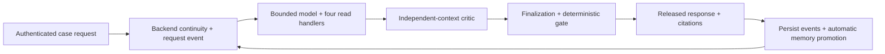
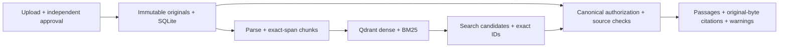

# Palladion

**An evidence-first agent harness for answers that can be checked.**

Palladion investigates how an agent can keep claims attached to authoritative evidence,
recognize when evidence is insufficient, preserve case context, and challenge its own
conclusions before release. The initial research domain is support investigation using
fictional payment documents and read-only mock operational systems.

The project is being built system-first, without a UI. Its research claims remain
hypotheses until tested against controlled baselines and held-out cases.

**Current state:** P01–P03 are verified. P04's bounded runtime, four read tools, claim
gate, messages/citations, scoped developer traces/readiness and cancellable search worker
are verified through actual provider/HTTP/wheel checks and independent end-review
resolution. P04/P05 are published; scoped memory/continuity is verified complete. P06 independent critic, bounded counter-search and final gate are verified with installed/live checks and end-review resolution. Its paired synthetic experiment remains neutral for full exception correction. No UI or research-hypothesis success is claimed. All passing and failed model
checks and current gates are recorded in [progress](palladion/docs/development/PROGRESS.md).
P07 is complete within its engineering scope: opt-in source graph, backend sessions and
automatic memory promotion passed actual consumer checks and independent review. The
paired graph pilot found no incremental exception recovery; graph stays disabled by default.
P08's engineering pilot is complete: 44 observations across 11 arms, including 16
row-level errors. All 24 integrity controls pass on the supplied tests, and the
independent review is resolved. The pilot does not establish the hypothesis or
independently adjudicated semantic accuracy. Unobserved higher-stage retrieval metrics
are explicitly unavailable in the [results](palladion/docs/development/evidence/P08_RESULTS.md).
Retrieval uses real dense/BM25 Qdrant; the Docker-free WSL launcher is documented in the
[application README](palladion/README.md). Generative commands explicitly enable Groq
Qwen3.8-27B, GPT-OSS120B or GPT-OSS20B; retrieval-only checks need no provider call.

## Core terms

| Term | Meaning in Palladion |
|---|---|
| **Tenant / principal** | A tenant is an isolation boundary; a principal is a persisted authenticated user with current roles and grants. A principal ID in request text grants no access. |
| **Case** | An authorized investigation workspace connecting approved sources, operational targets, policy decisions and audit history. Membership is checked again when data is read. |
| **Session** | One user's explicit conversation within a case, with start/end lifecycle. A case can outlive many sessions; episodic memory is session-bound. |
| **Document / revision** | Supplied source material and its immutable content-addressed version. Upload produces a draft; a separate authorized actor approves it. Wording such as “approved” inside the source has no authority. |
| **Chunk / citation** | A bounded exact text span and a reference that can read that span back under current access, approval, applicability and generation checks. A citation establishes provenance, not semantic entailment by itself. |
| **Generation** | A particular parsed/embedded index publication. It becomes ready only after expected IDs, hashes and representation identities match physical readback. |
| **Policy** | An externally approved, source-linked deterministic rule table with applicability and trusted time/input requirements. The model cannot invent a policy winner. |
| **Live observation** | The timestamped result of an allowlisted operational read. This prototype uses fictional mock systems; “live” describes the tool boundary, not a production database connection. |
| **Memory** | Persisted unverified context with provenance, scope and validity controls. Semantic memory holds private user preferences across sessions; episodic memory belongs to one session; procedural memory records unapproved tool/workflow experience. None becomes company policy automatically. |
| **Continuity packet** | Backend-built bounded context for the next request: current goal, gaps, rechecked handles, memory and own-session conversation turns. It is untrusted context, not new evidence authority. |
| **Critic / gate** | The critic challenges a draft in a separate model context. The deterministic gate decides which claims may be released under canonical checks. Model agreement is not independent truth. |
| **Graph** | Optional source-proven navigation between chunks/entities. Relations help discover sources; they cannot authorize an answer or override policy precedence. |

## From a question to an answer

The backend authenticates the caller and case, builds continuity without a model call,
and persists the current request. The model may request one of four read tools:
`search_knowledge`, `lookup_live_data`, `evaluate_policy` or `recall_memory`. Backend
handlers validate each request, enforce scope and budgets, and return typed results.
The independent-context critic challenges the draft before finalization. The gate
then rechecks canonical evidence and releases qualified claims or an honest lack of
verification. The backend persists the released response and automatically classifies
eligible event chunks for future memory.



Document ingestion is a separate flow: upload → independent approval → parsing and
index publication → current authorized search/citation reads. It does not turn every
document into a user preference. Runtime memory promotion and continuity construction
are automatic in ordinary serving; the additional `recall_memory` tool is selected by
the model when useful. Explicit administrative corrections, wider sharing and optional
Path B embedding jobs remain controlled operations.

P10 adds weighted deterministic classification, bounded conversation context, typed
graph-link administration and extra text/PDF formats. Its current verification and
limitations are tracked in [P10 evidence](palladion/docs/development/evidence/P10_CLASSIFICATION_AND_FORMATS.md).

## What works today

- Typed contracts, persisted identities, tenant/case membership and source ACLs.
- Immutable originals, independent upload/approval actors and source revocation.
- Exact-span chunks and a SQLite catalog that publishes generations after exact index readback.
- Real Qdrant dense/BM25 search, native RRF and an independent exact-identifier path.
- Canonical evidence checks, bounded optional reranking and context expansion.
- Authenticated local upload, approval, search, citation and index-coverage endpoints.
- Retrieval-only pilot reports with representation identities, raw ranks and failure accounting.
- Approved time-aware policy definitions, bounded predicate execution and persisted decision replay.
- Four named mock operational reads with target authorization, explicit errors, deadlines and freshness.
- Bounded real-Groq agent, four validated tool handlers and a deterministic claim gate.
- Authenticated messages, current citation readback, redacted timelines and scoped admin traces.
- Explicit dependency readiness, persisted failures and cancellable local search workers.
- Scoped memory, auditable owner/admin validity controls, FTS recall and bounded continuity packets.
- Independent advisory critique, bounded counter-search, review-aware finalization and canonical qualification of changed/unresolved proposals.

Search results are discovery candidates. Before returning text, Palladion rechecks stored
identity, scope, approval, applicability, generation and original bytes. Search scores and
model output do not give a source authority.



P04 implements the bounded agent loop, four read-tool handlers, generated drafts and
necessary-condition release gate. P05 adds scoped memory, owner-controlled validity,
FTS recall and revalidated continuity/cache. P06 implements independent-context
criticism, scoped counter-search and review-aware finalization/gating. P07 adds optional
graph navigation and deterministic memory categorization, with a separately enabled local
cosine supplement. P08 implements explicit experimental controls and replayable pilot
measurements; confirmatory research still requires independent adjudication. Enterprise identity integration
remains outside this synthetic prototype.

## Run and explore

Start with the [application setup guide](palladion/README.md) for uv, the Docker-free
Qdrant launcher, synthetic seeding, API routes and validation commands.

```powershell
cd palladion
uv sync --locked
uv run --locked --no-env-file python scripts/validate_foundation.py
uv run --locked --no-env-file python scripts/check_dependencies.py --self-test
uv run --locked --no-env-file python scripts/validate_policy.py
```

These checks need no provider credentials. Retrieval additionally requires local Qdrant
and initially downloads pinned local model assets. Windows verification uses WSL Ubuntu
with Linux-owned storage; x86_64 Linux can run the standalone launcher directly.

## Documentation and repository

- [Documentation entry point](palladion/docs/README.md)
- [Master vision](palladion/docs/vision/palladion-blueprint-v2.md)
- [Master development plan](palladion/docs/development/MASTER_DEV_PLAN.md)
- [Current progress and next task](palladion/docs/development/PROGRESS.md)
- [Project instructions](AGENTS.md)

`palladion/` owns the system. `baseline/` is reserved for later comparisons with standard
RAG, LangChain RAG, and provider systems. The immediate priority is system behavior and
falsifiable hypothesis testing. UI development is excluded.

Documentation validation (Python standard library only, from repository root):

```powershell
python palladion/docs/development/check_docs.py
python palladion/docs/development/check_docs.py --self-test
```

These commands validate the documentation's structure and references, not system behavior.

| Path | Purpose |
|---|---|
| `palladion/src/evidence_agent/` | Implemented system modules |
| `palladion/scripts/` | Setup, validation, reconciliation and measurement entry points |
| `palladion/tests/` | Contracts, authorization, ingestion and real retrieval consumers |
| `palladion/data/demo/` | Fictional sources and pilot fixtures |
| `palladion/docs/development/` | Atomic plan, ADRs, gates, evidence and current status |

## Verification and research limits

The historical P02 checkpoint passed 117 real-server-enabled tests, strict typing, lint, build and an
isolated installed-wheel HTTP smoke. The dependency/completion audit and its
results are recorded in the [evidence log](palladion/docs/development/EVIDENCE_LOG.md).
Tests without explicit real-server enablement skip integration cases.

The current pilot has eight synthetic queries over a tiny corpus and lacks independently
adjudicated labels. English/Indonesian query coverage does not establish general multilingual
quality. Retrieval metrics do not establish answer correctness, production readiness or
superiority. External comparator implementations and full answer-system experiments remain
future work. P00–P08 are complete within their recorded engineering-pilot boundaries; P09 audit remediation is ongoing and PF03 performance acceptance remains open. Check the progress record for current evidence and unresolved gates.

The post-completion P09 reaudit and benchmark handoff follow-up is recorded in the
[master plan](palladion/docs/development/MASTER_DEV_PLAN.md#p09--post-completion-audit-and-benchmark-handoff).
It covers historical document search, approval-owned exact identifiers, batched physical
coverage, optional HTTP evidence budgets and scoped synthetic administration. The
[application guide](palladion/README.md#search-and-administrative-contracts) describes
these contracts and their limits. P09 also closes a missing-review gate conjunction and
corrects evaluation deadline/reproducibility/completeness claims; immutable pilot failures
and unknown semantic metrics remain visible.
