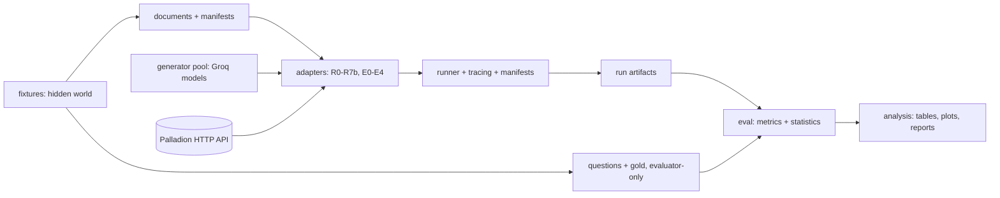

# Benchmark project map

Updated 2026-10-18. Shows what exists and what is planned. Planned paths are not built. Mark uncertainty rather than guessing.

## Exists now

| Path | Role |
|---|---|
| `docs/vision/palladion_retrieval_benchmark_research_protocol.md` | Vision and methodology (unedited) |
| `docs/development/` | Plan, goal, progress, ADRs, gates, protocol, traceability, memory, map, learning, risks, evidence, `check_docs.py` |
| `README.md`, `AGENTS.md`, `docs/README.md` | Entry points and project instructions |
| `pyproject.toml`, `uv.lock`, `.gitignore`, `.env.example`, `Makefile`, `docker-compose.yml` | uv project, dev commands and an optional pinned Qdrant service (B00-T03.02, B01-T01.01) |
| `benchmark/` | `contracts`, `config`, `registry`, `run_manifest`, `tracing`, `runner`, `cli`, `generator`, `secret_scan` and an empty `adapters/` package (B01) |
| `configs/` | `benchmark.yaml`, `comparators.yaml`, `evaluation.yaml`, `fixtures.yaml` (B01-T02.03) |
| `tests/` | 371 tests for the B01 modules |
| `docs/reproducibility.md` | Reproducibility checklist, started in B01-T03.02 |

## Planned structure (owners in the atomic register)

| Planned area | Files (phase) |
|---|---|
| Harness | `benchmark/{contracts,registry,run_manifest,tracing,runner,cli,generator}.py` (B01) |
| Configs | `configs/{benchmark,comparators,evaluation,fixtures}.yaml` (B01, tuned in B08) |
| Fixtures | `benchmark/fixtures/{entities,knowledge,operations,world,phrasebook,documents,artifacts,manifest,questions,question_gen,live_api,validation,audit}.py` (B02), `episodes`, `updates`, `mutations` (B07, built), extended B08 |
| Evaluation | `benchmark/eval/` normalize, evidence_sets, retrieval, statistics, cost_latency, score_run (B03, built); citations, policy, abstention, judge_audit (B05); memory, critic, tool_use (B07) |
| Adapters | `benchmark/adapters/` common, models, bm25, dense, hybrid, palladion (B04, built); hipporag2, graphrag, lightrag with `worker.py`, `comparators/` and `llm_proxy.py` (B06, built and tested offline; the live pilot is partial); langchain, langgraph, google_adk (B07) |
| Analysis | `benchmark/analysis/tables.py` (B03, built); `plots.py`, `reports.py` (B08) |
| Scripts | `generate_data.py` (B02), `qdrant_server.py`, `palladion_runtime.py`, `build_indices.py`, `run_track_a.py`, `score_track_a.py`, `validate_results.py` (B04, built); `benchmark/track_a.py` and `benchmark/results_check.py` hold their logic; `run_track_b.py` (B05), `run_track_c.py` (B07) |
| Tests | the eight protocol test files plus `test_generator_pool.py`, owned by the same cards as their modules |
| Docs | `scoring_rubric.md`, `annotation_guide.md` (B05, built); `reproducibility.md` (B01, final B08); `dataset_card.md` (B02) |

Generated data stays outside git under `artifacts/` (corpora, fixtures with evaluator-only gold, runs, reports), referred to by manifest IDs.

## Dependencies outside this folder

| Dependency | Use | Rule |
|---|---|---|
| `palladion/` HTTP interface | R7a/R7b/E3/E4 adapters | Read live source for the contract; never import, edit or stage (BADR-0002); contract uncertain, see OQ03 |
| Groq models (qwen/qwen3.8-27b, openai/gpt-oss-120b, openai/gpt-oss-20b) | Shared generator, judges, optional paraphrase | Explicit enable, recorded per call (BADR-0007, BADR-0013) |
| Qdrant, Neo4j, comparator repos | Index backends and arms | Optional services behind profiles; comparators isolated and pinned (BADR-0005) |
