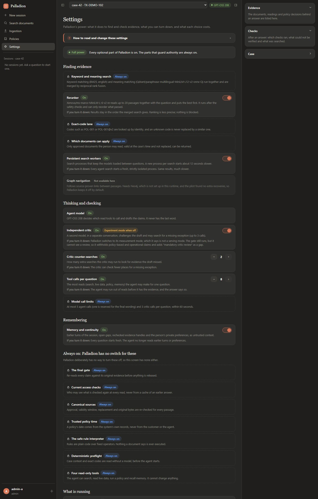
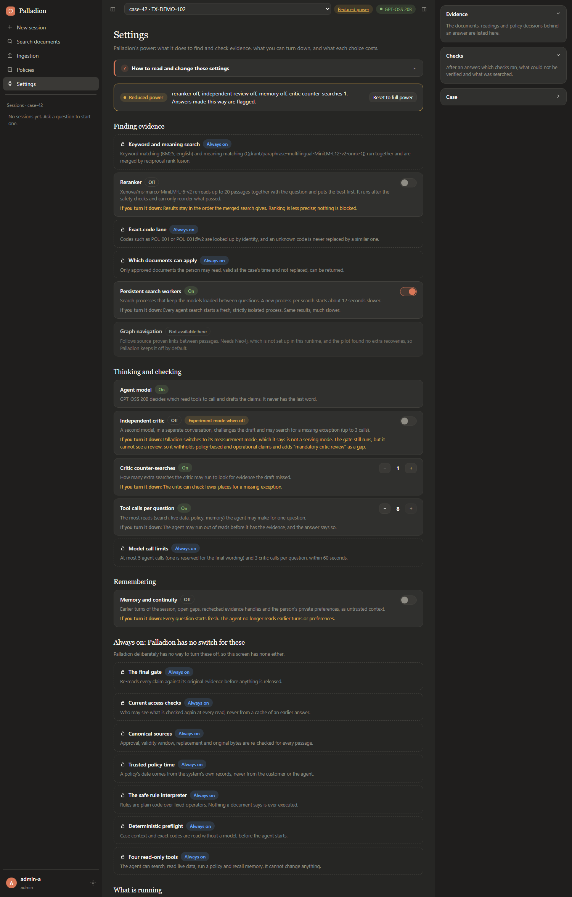

# Palladion UI

A local operator UI for [Palladion](../README.md): chat with the evidence behind every claim, document ingestion, and
policy creation. It is a thin client. It holds no evidence authority: every answer, citation and decision is read from
Palladion's own API, under the signed-in identity's current access. Synthetic data only.

**Status:** working against a real Palladion with GPT-OSS 20B (see [docs/TESTING.md](docs/TESTING.md) for exactly what
was and was not verified). Not production software: authentication is Palladion's synthetic demo tokens.

## What it shows


Both are real GPT-OSS 20B answers on the fictional demo case (see [docs/TESTING.md](docs/TESTING.md)). Regenerate them
with `uv run python -m scripts.screenshot`.

| Screen | What it does |
|---|---|
| **Chat** | Streams live progress, then the released answer. Shows the verdict badge, verified claims with clickable evidence, a checklist of what must happen before anyone acts, unverified possibilities, tool status, "a system timed out" notices and a standing "only supplied documents were searched" note. Select a citation to read the exact evidence in the side panel. |
| **Evidence panel** | Collapsible Reading, Evidence, Checks and Case sections. Documents show the exact text re-read from the original file; live readings show system and time; policy decisions show version, basis and the source clauses. |
| **Search documents** | Retrieval only, no model: ranked passages with how many candidates the checks excluded. |
| **Ingestion** | Drop or paste documents, set validity dates, see the draft → approved → searchable steps. A different person must approve. |
| **Policies** | A five-step wizard builds a policy from a cited passage in plain words, reads it back, validates it, and registers it. Lists, revokes and records replacements. |
| **Settings** | Palladion's power at a glance: what is on, the real model names, and switches for the reranker, the independent critic, memory, the critic's counter-searches, the tool-call budget and the persistent search workers, each with what turning it down costs. Always-on layers (the final gate, access checks, canonical sources, trusted policy time, the safe rule interpreter, the preflight, the read-only tools) are shown locked. Changes restart Palladion; a "Reduced power" chip and a notice on each answer show when anything is turned down. |
| **Model menu** | Search only, or one of Palladion's three Groq models. Choosing one is the explicit enablement: it restarts Palladion with that model. |

**Streaming, and why it is not token streaming.** Progress is live (read from Palladion's case timeline while it works).
The answer is revealed piece by piece only *after* Palladion's gate has re-read the evidence. Raw model tokens are never
shown, because until the gate runs a sentence is a proposal, not an answer.

## Settings





Only levers Palladion itself supports are used: its validated settings file, the reranker switch on its server, and the
evaluator arm that skips the independent critic. The UI writes the settings file to `.runtime/palladion-settings.yaml`
and remembers your choices in `.runtime/ui-power.json`; a missing or damaged file means full power, never a silently
reduced setup.

## Adding documents and policies

Every screen has a how-to guide at the top: how to read an answer (Chat), how to add a document (Ingestion), and what a
policy is, with a worked example, and how to make one (Policies). They open the first time and remember if you close them.


Captured against the real Palladion in search-only mode (no model). Deep links make them reproducible:
`?as=<identity>` signs in as a demo identity, and on Policies `?example=1&step=4` opens the example at its review step
(`uv run python -m scripts.screenshot --route policies --query "as=admin-a&example=1&step=4" --out ...`).

## Run it

Prerequisites: `uv`, WSL Ubuntu with Palladion's Qdrant binary (see the [application README](../palladion/README.md)),
and a Palladion runtime provisioned under `.runtime/` (a clean worktree of a Palladion commit, its environment, the model
cache and a seeded data folder; see [Provisioning](#provisioning)).

```powershell
cd palladion-ui
uv sync
uv run python -m palladion_ui                              # search only: no model, no key, no quota
uv run python -m palladion_ui --model openai/gpt-oss-20b   # start the agent now (reads GROQ_API_KEY from ../.env)
```

Open <http://127.0.0.1:8765>. The UI starts Qdrant (port 17533) and Palladion (port 18480) itself and stops only what it
started. Use **Acting as** (bottom left) to switch demo identities: `reader-a` asks questions, `uploader-a` uploads,
`admin-a` approves and manages policies.

No Palladion available? `uv run python -m scripts.dev_fake` serves the same UI against a deterministic fake on
<http://127.0.0.1:8766>. It is for looking at screens, not for judging Palladion.

## The dev suite

```powershell
uv run python -m scripts.check     # ruff, server tests, front-end syntax, front-end tests; no model or quota
```

## Provisioning

`.runtime/` is not committed. One-time setup, as done for the verified run: `git worktree add --detach
.runtime/palladion-src <commit>` (a commit that contains the policy and source-listing routes and the persistent search
workers; the last run used `68f6df6`), `uv sync
--frozen` inside `.runtime/palladion-src/palladion`, copy `palladion/runtime/model_cache` into that folder's
`runtime/`, then seed with `scripts/seed.py --policies --root ../../data --url http://127.0.0.1:17533 --collection
palladion_ui_dev`. The UI runs a clean worktree so another contributor's in-progress edits to `palladion/` can't break it.

## Needs two Palladion routes

The UI uses `GET /v1/cases/{id}/sources` and `POST|GET /v1/admin/policies` (and `/revoke`, `/supersede`). They are
**uncommitted changes in `palladion/`** at the time of writing (see `palladion/tests/test_policy_admin_api.py` and
`test_source_list_api.py`). Without the source listing the Ingestion screen falls back to documents uploaded through
this UI; without the policy routes the Policies screen shows an error.

## Security notes

Palladion's demo tokens stay on this server; the browser holds only an identity name in a cookie. The server answers only
on localhost, and refuses writes without an `X-Palladion-UI` header, so another website can't drive it. The Groq key is
read only when a model is explicitly chosen and passed to the child process through its environment. Document text is
rendered with `textContent` only.

## Troubleshooting

* **Qdrant "did not start in time" though it runs inside WSL:** WSL's localhost forwarding is broken. Never kill
  `wslrelay.exe` processes to stop things. If it happens, `wsl --shutdown` (after checking nothing else needs WSL),
  then choose the model again.
* **"Review: unavailable" with provider HTTP 429:** the Groq quota is used up. The UI shows it as it is; wait for the
  quota to renew.
* **"Port 18480 is already in use by a Palladion this UI did not start":** stop the other one, or set
  `PALLADION_UI_UPSTREAM_PORT`.
