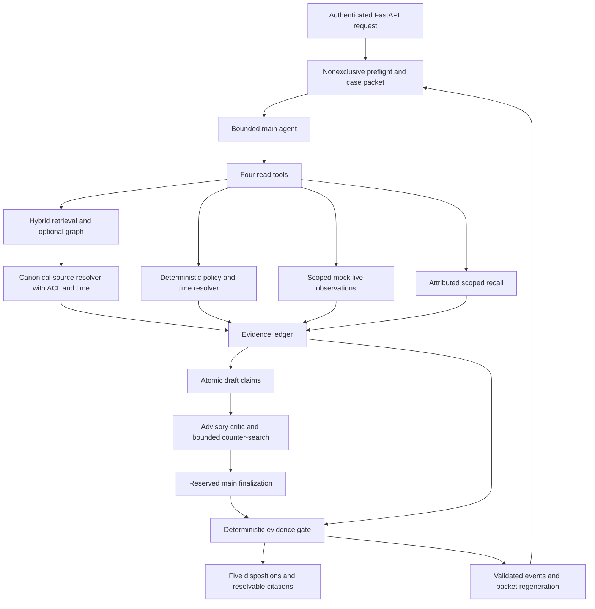

# Project map

Verified 2026-10-17. **Actual documentation is distinct from planned runtime components.**
Source: blueprint “Concrete prototype repository,” “Directory responsibilities,” and “System
architecture.” No diagram node below implies shipped code.

## Actual repository

```text
C:/palladion/                         Git root, main; initial revision 9b167a2
  AGENTS.md                          Project entry instructions
  README.md                          Project introduction and navigation
  .env                               User-supplied ignored credential file; not read/copied
  .gitignore                         User-owned/untracked at this task's initial inspection
  baseline/                          Existing empty directory; reserved, not tracked as a directory
  palladion/
    docs/
      README.md                      Documentation index
      vision/
        palladion-blueprint-v2.md     User's unchanged master vision
      development/                   One canonical agent working-document folder
        MASTER_DEV_PLAN.md           Task protocol, packages, atomic file-specific cards
        GOAL.md                      Checkable outcomes
        ADR_LOG.md                   Structured questions/recommendations/editable owner answers
        TESTING_GATES.md             Proof obligations
        RESEARCH_PROTOCOL.md         Experiments and honest comparison rules
        REQUIREMENTS_TRACEABILITY.md Blueprint/user requirement coverage
        PROJECT_MEMORY.md            Single compact recovery record
        PROJECT_MAP.md               This map
        PROJECT_LEARNING.md          Lessons and corrections
        PROGRESS.md                  Task/gate states
        RISKS_AND_OPEN_QUESTIONS.md   Accepted directions, pending evidence and deferred scope
        EVIDENCE_LOG.md              Verification records
        check_docs.py               Links/IDs, atomic metadata/dependencies, planned-file coverage
```

## Planned runtime ownership

All paths here are relative to `palladion/` and **not implemented**. ADR-0001 maps the
blueprint's illustrative `evidence-agent/` root here; do not create a duplicate project.

| Planned area | Owns | Producers / consumers | Build phase |
|---|---|---|---|
| `pyproject.toml`, `uv.lock`, config, compose | uv-managed app environment, pins, flags/budgets and local services | Settings → application and evaluator | P01/P02 |
| `src/evidence_agent/core/` | Versioned typed contracts, IDs and errors | All modules share these; no storage→agent dependency | P01 |
| `security/access.py` | Principal authentication and tenant/case/role/source permissions | Request context → every domain/source boundary | P01 onward |
| `storage/` and immutable originals | SQLite registry/schema/exact IDs, source bytes, Qdrant/Neo4j adapters | Ingest writes; resolver and domain readers consume | P01/P02/P07 |
| `ingest/` | Parse/chunk metadata, staged generations, reconciliation, optional graph extraction | Accepted original → derived stores → publish marker | P02/P07 |
| `retrieval/` | Dense/BM25/exact fusion, rerank/context, canonical evidence, required slots | Index candidate IDs → authorized original spans/ledger | P02 |
| `policy/` | Approved rule discovery, temporal version selection, bounded typed AST | Source clauses + trusted facts → decision trace | P03 |
| `live/` | Named allowlisted read-only operations, target auth, timestamps/freshness | Mock owned observations → ledger/policy facts | P03 |
| `agent/` | Preflight, four tool facades, bounded loop, draft, critic, final gate | Domain evidence → qualified claims and disposition | P04/P06 |
| `memory/` | Scoped events/facts, FTS recall, generated packet, scoped hot cache | Validated events → next authorized request | P04 skeleton/P05 |
| `graph/` | Verified/provisional identity and typed source-backed relationships | Reviewed source extraction → optional bounded discovery | P07 |
| `api/`, `main.py` | Transport, app wiring, auth boundary, messages/evidence/timeline/trace/health | Operator request → runtime; citations → source reader | P02/P04 |
| `telemetry/audit.py` | Redacted correlated trace, counters and cost/failure data | Every runtime stage → evaluator/debug authorized reader | First runtime slice onward |
| `data/demo/`, `tests/`, `scripts/` | Synthetic fixtures, gates, evaluation/reconciliation | Known expected evidence → actual run artifacts → scorer | P01 onward |

Do not create all 74 proposed files as empty placeholders. Check named APIs/dependencies
at implementation time. No frontend, autonomous financial actions, event broker or extra
agent role is required by the prototype.

Current owner choices: uv venv lives inside `C:/palladion/palladion`; later baseline
dependencies are isolated. Main/critic initial runtime uses actual Groq
`qwen/qwen3.8-27b`, independent contexts with shared model, not independent ground truth.
Root `.env` is loaded only for an enabled future command; package/model execution waits
for GO. The `.venv`/lock/manifest here are planned unless observed later; no provider
or environment setup was performed by this documentation task.

## Planned request and evidence flow



The renderer uses safe templates if budget/model output fails. Identity never comes from
tool arguments or packet text. Both retrieval and graph resolve to original authorized
spans; neither graph connectivity nor score creates policy authority. The gate owns release,
but it is not a complete natural-language theorem prover.

## Planned ingestion and future evaluation flow

Immutable bytes + authenticated metadata → registry → structural chunks with exact spans →
hidden dense/BM25/exact and optional graph generation → manifests/reconciliation → atomic
SQLite publication marker → canonical resolver → citation GET. Revocation acts in SQLite
immediately; asynchronous index/cache cleanup cannot be the access-control boundary.

Future `baseline/` systems → shared evaluation contract ← Palladion arms → frozen corpus,
gold labels and scorer → report with raw safety/usefulness/latency/cost dimensions. All
comparison adapters and results are currently absent; see RESEARCH_PROTOCOL and X01.
