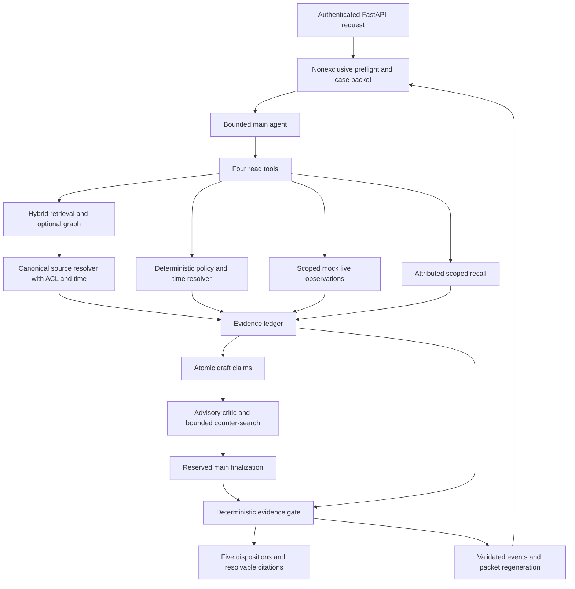

# Project map

Current checkpoint 2026-10-20: P09 audit and benchmark-handoff remediation ACTIVE. P00–P08 are historical completed pilot work (98 cards); independent reaudit identified and corrected gate/evaluation proof gaps; P09 remains active for PF03 performance acceptance. See evidence/P09_AUDIT_AND_HANDOFF.md and ADR-0087–0095; PF03 performance remains open after owner-rejected0091 closure; opaque IDs and opt-in5second audit reuse are approved and implemented. Benchmark implementation/editor work, UI and enterprise writes remain excluded; owner authorized a scoped verified main push.

Updated2026-10-20; published P07 proof is E-P07-002; P08 engineering pilot completed at E-P08-001–003; current P09 proof is E-P09-001–004, with PF03 acceptance open. **Actual documentation is distinct from planned runtime components.**
Source: blueprint “Concrete prototype repository,” “Directory responsibilities,” and “System
architecture.” No diagram node below implies shipped code.

## Actual repository

```text
C:/palladion/                         Git root, main; initial revision 9b167a2
  AGENTS.md                          Project entry instructions
  README.md                          Project introduction and navigation
  .env                               Ignored credentials; read only by explicitly enabled commands, never copied/exported
  .gitignore                         Owner-provided .env/.venv exclusions, published unchanged
  baseline/                          Reserved for later comparator implementations
  palladion/
    .venv/                           Reused ignored uv environment; locked app/development dependencies
    pyproject.toml, uv.lock          Package metadata and locked dependencies
    README.md, .gitignore            Runnable foundation instructions and local exclusions
    .env.example                     Non-secret future command enablement template
    config/                          Typed settings and fictional policy fixture
    data/demo/                       Four originals, synthetic case/observation/gold catalog
    src/evidence_agent/              core/, security/, storage/, ingest/, retrieval/, policy/, live/, agent/, memory/, graph/, api/
    scripts/validate_foundation.py    Offline actual-domain consumer smoke; additional serve/seed/reconcile/pilot CLIs
    tests/                           Source/domain/runtime/memory/graph/security and actual-server consumer checks
    docs/
      README.md                      Documentation index
      vision/
        palladion-blueprint-v2.md     User's unchanged master vision
      development/                   One canonical agent working-document folder
        MASTER_DEV_PLAN.md           Task protocol, packages, atomic file-specific cards
        GOAL.md                      Checkable outcomes
        ADR_LOG.md                   Structured questions/recommendations/editable owner answers
        TESTING_GATES.md             Proof obligations
        RESEARCH_PROTOCOL.md         Experiments and honest comparison rules
        REQUIREMENTS_TRACEABILITY.md Blueprint/user requirement coverage
        PROJECT_MEMORY.md            Single compact recovery record
        PROJECT_MAP.md               This map
        PROJECT_LEARNING.md          Lessons and corrections
        PROGRESS.md                  Task/gate states
        RISKS_AND_OPEN_QUESTIONS.md   Accepted directions, pending evidence and deferred scope
        EVIDENCE_LOG.md              Verification records
        check_docs.py               Links/IDs, atomic metadata/dependencies, planned-file coverage
```

## Ingestion/retrieval now implemented (P02, verified with audit resolution)

`ingest/` parses original spans, chunks structural context and stages exact generations.
`storage/catalog.py` owns additive v3 chunks/manifests/aliases/context links. The real
Qdrant adapter stores named neural dense/native BM25 points; `retrieval/` canonicalizes
ACL/approval/time/generation and supports bounded learned rerank/context expansion.
`api/` and main factory expose authenticated source/search/citations; telemetry has an
internal correlated reader. Seed/reconcile/serve/evaluate scripts use those actual owners.
WSL standalone launcher verifies Qdrant release hashes and preserves Linux-owned storage.
Compose is optional. P03 implements the policy/live domain path below; P04 runtime and P05 continuity are verified; P06 critic is verified at E-P06-002. P07 graph and automatic memory consumers are implemented and tested; sole end-review documentation corrections are verified. Graph stays off by default after zero incremental recoveries in the frozen paired pilot.

## Foundation now implemented (P01)

The app package/uv.lock/settings, core models/errors/IDs/fixtures, security access,
SQLite schema/migrations/registry/originals, synthetic data/policy, tests and offline
scripts/validate_foundation.py now exist. Offline flow: typed fixtures → trusted bootstrap
profiles/memberships → Registry upload/independent approval → OriginalStore exact bytes →
close/reopen Database → current stored ACL and approved-source reader → byte/range proof.
CLI state is temporary and cleaned; no API/search/provider process is started.

## Runtime ownership and later planned components

Paths are relative to `palladion/`; P01/P02 and the P03 domain path are implemented; P04 runtime and P05 scoped memory are verified; P06 critic is verified at E-P06-002; P07 graph and automatic memory are implemented with final gates/audit verified. ADR-0001 maps the
blueprint's illustrative `evidence-agent/` root here; do not create a duplicate project.

| Area and phase ownership | Owns | Producers / consumers | Build phase |
|---|---|---|---|
| `pyproject.toml`, `uv.lock`, config, compose | uv-managed app environment, pins, flags/budgets and local services | Settings → application and evaluator | P01/P02 |
| `src/evidence_agent/core/` | Versioned typed contracts, IDs and errors | All modules share these; no storage→agent dependency | P01 |
| `security/access.py` | Principal authentication and tenant/case/role/source permissions | Request context → every domain/source boundary | P01 onward |
| `storage/` and immutable originals | SQLite registry/schema/exact IDs, source bytes, Qdrant/Neo4j adapters | Ingest writes; resolver and domain readers consume | P01/P02/P07 |
| `ingest/` | Parse/chunk metadata, staged generations, reconciliation, optional graph extraction | Accepted original → derived stores → publish marker | P02/P07 |
| `retrieval/` | Dense/BM25/exact fusion, rerank/context, canonical evidence, required slots | Index candidate IDs → authorized original spans/ledger | P02 |
| `policy/` | Approved rule discovery, temporal version selection, bounded typed AST | Source clauses + trusted facts → decision trace | P03 |
| `live/` | Named allowlisted read-only operations, target auth, timestamps/freshness | Mock owned observations → ledger/policy facts | P03 |
| `agent/` | Preflight, four tool facades, bounded loop, draft, critic, final gate | Domain evidence → qualified claims and disposition | P04/P06 |
| `memory/` | Scoped events/facts, FTS recall, generated packet, scoped hot cache | Validated events → next authorized request | P04 skeleton/P05 |
| `graph/` | Verified/provisional identity and typed source-backed relationships | Reviewed source extraction → optional bounded discovery | P07 |
| `api/`, `main.py` | Transport, app wiring, auth boundary, messages/evidence/timeline/trace/health | Operator request → runtime; citations → source reader | P02/P04 |
| `telemetry/audit.py` | Redacted correlated trace, counters and cost/failure data | Every runtime stage → evaluator/debug authorized reader | First runtime slice onward |
| `data/demo/`, `tests/`, `scripts/` | Synthetic fixtures, gates, evaluation/reconciliation | Known expected evidence → actual run artifacts → scorer | P01 onward |

Do not create all 74 proposed files as empty placeholders. Check named APIs/dependencies
at implementation time. No frontend, autonomous financial actions, event broker or extra
agent role is required by the prototype.

Current owner choices: uv environment remains inside the application. Explicit Groq
commands select Qwen3.8-27B, GPT-OSS120B or GPT-OSS20B (ADR-0036); no hidden fallback.
Transport→loop→Tools.execute handles native calls with server identity and persisted
results. Root .env is read only by enabled commands. P01/P02/P03 and current P04
engineering proofs exist; P06 independent critic is verified; P08 scientific evaluation remains.
The root also contains separately owned palladion-benchmark work; it is outside P07.

## Implemented request and evidence flow (P01–P07)



The renderer uses safe templates if budget/model output fails. Identity never comes from
tool arguments or packet text. Both retrieval and graph resolve to original authorized
spans; neither graph connectivity nor score creates policy authority. The gate owns release,
but it is not a complete natural-language theorem prover.

## Implemented ingestion and future evaluation flow

Immutable bytes + authenticated metadata → registry → structural chunks with exact spans →
hidden dense/BM25/exact and optional graph generation → manifests/reconciliation → atomic
SQLite publication marker → canonical resolver → citation GET. Revocation acts in SQLite
immediately; asynchronous index/cache cleanup cannot be the access-control boundary.

Future `baseline/` systems → shared evaluation contract ← Palladion arms → frozen corpus,
gold labels and scorer → report with raw safety/usefulness/latency/cost dimensions. These are deferred baseline/ and P08 obligations; separately owned palladion-benchmark/ work is outside this phase. See RESEARCH_PROTOCOL and X01.

Dependency manifest ownership is checked by scripts/check_dependencies.py over src/scripts/tests (including literal dynamic imports); pyproject runtime/dev declarations and uv.lock own dependency setup. E-P02-002 records the follow-up completion checks.

## P03 domain path (implemented and phase-reviewed)

Authenticated source-linked policy approval → policy_versions/source clauses plus append-only approval/revocation/supersession events → temporal resolver. Admin-registered case scope → named target-authorized mock gateway → minimized persisted LiveObservation events → PolicyEngine evidence-ID reader → normalized safe AST execution → persisted PolicyDecision → reopened replay/source reader. Policy/live modules share existing SQLite, original bytes and access checks; schema remains v3. scripts/validate_policy.py exercises the real path without Qdrant/network/provider. P04 owns gate/tool/API integration.

## P04 implemented path (verified with end-review resolution)

Explicit serve/validation command → actual Groq chat-completions transport → exactly
four backend-scoped tools → existing canonical search/policy/live/case readers →
current-request typed ledger → bounded draft/unavailable-review/finalization →
necessary-condition gate → safe renderer → append-only request/attempt/release events.
Authenticated /v1/cases/{case_id}/messages, /timeline and /v1/evidence/{evidence_id}
consume that path; services own SQLite/gateway lifetime and close on application exit.
Approved ADR-0031/0032 implemented: admin AND current-case developer trace; SQLite/
Qdrant/config readiness (no provider call); bounded credential-free search_worker
process invokes existing HybridSearch/Qdrant/canonical readers and is terminated/joined
on cancellation/deadline. agent/llm.py transports; loop.py budgets/correlates native calls;
tools.py handles validated dispatch and persists results. Explicit three-model Groq
selection is ADR-0036; source presence alone does not prove all live behavior.
P04 phase closure is evidenced at E-P04-001, including updated installed consumers and
single end-review resolution. Public event/recall reads redact raw questions/prompts;
internal packet reports are owner-scoped and UNVERIFIED. Search scope reflects executed
retrieval. Semantic/critic/research success is not inferred from source presence.


## P05 implemented path (phase-local verification and audit complete)

Trusted local operator/application → MemoryStore owner/admin and current scope checks →
immutable memory_entries + memory_provenance and auditable case events. Team scopes
use memory_team_memberships, not tenant/name inference. v4 migration adds FTS5 and
provenance without rewriting legacy rows; recognized existing stores get checked,
exclusive SQLite backups before upgrade. memory.py is a trusted local filesystem
operator CLI, not multiuser authentication or an LLM write surface.

Current principal/case/team/source → exact/structured/FTS recall → context-only memory
records. build_packet derives reported/hypothesis/historical observation/open-question/
attempt/handle fields from their actual producers; metadata is never current authority.
CaseStore.unresolved_questions replays authorized decisive policy traces so empty failed
replies cannot erase open inputs; an executed resolving policy clears those fields.
preflight → loop forwards those fields; model requests fresh domain reads; ledger/gate
revalidate material claims. AgentServices owns bounded HotCache; every hit revalidates
canonical original bytes/ACL/time/generation and owner epoch. Correction/close/team/source
changes prevent stale reuse. Only exact passages cached, no generated-answer cache.

Settings.continuity_enabled defaults true; evaluator-only B4 disables packet/recall.
packet_max_chars defaults6000, compressed pilot1500; current full query still reaches
model separately from compact packet goal. Actual provider usage remains separate from
character counts. evaluate.py --memory → real model/API outputs → score_continuation →
PILOT report with all failed conditions. P06 critic/P07 graph/P08 confirmation remain.

E-P05-001 verifies the above consumer paths. Recall scope/active metadata filters before its bounded candidate window; full source checks remain afterward. Non-exhaustive coverage reaches the model. Provider pilot strictcompletion0/3 is retained; no semantic or H04 improvement claim.

## P06 implemented path (verified at E-P06-001/E-P06-002)

Budget → independent critic(question, canonical requirements, scoped identifier coverage,
evidence, initial draft) → at most2backend-scoped knowledge searches → later real review
of changed ledger → trusted reserved main finalization → canonical re-read/digest-bound
necessary-condition gate → safe message/citation/timeline. Pacing is opt-in/shared and
cancellable; caller authorization/freshness rechecks after waiting. Protected initial/
final proposals and reviews are excluded from all public event/recall/trace readers.
Critic verdict cannot create authority/conflict or waive human adequacy for operations.

Versioned evaluator saves question/draft/initial ledger once, readbacks equal hashes
across four conditions, persists actual outputs/attempts/usage and scores mechanical
controls. V2 launch-version16conditions retain negative/unknown outcomes. Current-source
real20B exact-clause recovery verifies a new appendix, subsequent review, full exception
quote and canonical API readback; it is not semantic ANN or general reliability proof.
Default-budget real generated-draft proof and lower-cap recovery are distinct. Graph,
adaptive trigger, held-out semantic accuracy and independent annotators remain P07/P08.

## Final-source P06 evidence boundary

P06 DONE at E-P06-001/E-P06-002: all six atomic cards, approved critic/status/pacing
contracts, actual source/installed/API consumers and sole Luna Medium end-review
resolution are verified. Source294PASS plus13 actual-Qdrant cases pass (12 in the sweep,
one isolated after a setup connection-abort) =307 disjoint checks. Installed294 and one
installed real-Qdrant/API case pass as overlapping artifact checks; all50 packaged files
match the final wheel. Ruff, strict mypy59, dependency81+4controls, foundation CLI and
final document gates pass. Original failed/skipped runs remain evidence, not PASS.

Post-fix real20B exact recoveryPASS39.827s (2main/2critic/1search, explicit cap2) and
serialized default-budget MODEL-draft pathPASS37.089s (4main/1critic/2tools) release the
full exception with original citation/timeline readback and no verification errors.
Gate qualifies a changed final proposal or unresolved CHALLENGE while preserving
canonical facts; unchanged current PASS remains eligible for SUPPORTED. Model review
is advisory, not semantic authority or payment permission.

Frozen prompt-version20B matrix cb9e66:16conditions,16/16known-fact retention,
0/4full-exception corrections, one critic validation failure,16main/17critic/4searches,
66117known received tokens (one attempt lacks usage). It precedes ADR0062's gate-only
qualification fix: no model prompt changed; raw outputs are not relabeled post-fix.
No efficacy/H05, semantic accuracy, causal false-veto or completeness claim. Mandatory
review remains enabled; draft-blind first pass sees canonical required slots (§10.1).
At the historical P06 checkpoint, P07 graph/P08 adjudicated research/X01 comparators remained deferred; no P07 GO or P06
main push is inferred. No unanswered P06 owner ADR. Owned processes stopped, storage
preserved and ports16333/16334/18080 verified free; foreign benchmark/editor work untouched.


P06 arm clarification: blind_requirements is draft-blind first-pass review under
blueprint §10.1; canonical policy-required slots remain supplied. It does not measure
independent discovery of unsupplied requirements. End-review R2 is withdrawn.

## P07 automatic promotion path (implemented; phase gates/audit verified)

Authenticated message + backend-owned session → immutable CaseStore event → bounded event/span chunks → deterministic PathA → optional existing-local-encoder cosine/loss PathB → canonical promotion decision/idempotent link → scoped MemoryStore → session-aware recall/continuity packet → next actual runtime request. Explicit preference → USER semantic; observed tool/workflow experience → unapproved procedural; other/uncertain → episodic session. Category is separate from access scope. Original case/source ACL and authorityNONE persist; canonical document/live/policy evidence and audit readers remain separate from session-filtered conversational memory. Migration6 and routes/store/packet/runtime/CLI/testing ownership: P07-T04.01–05.


## P08 implemented experiment and replay path (end review resolved)

Explicit evaluate.py --study + owner-frozen protocol → study.run_study → isolated
source-only observation snapshot → production retrieval/policy/runtime/tool consumers
→ per-attempt/model records + original canonical stores → hash-validated replay_study
→ score_study_rows/clustered_difference → bounded public receipt and P08_RESULTS.
B7 adaptive/B8 planner controls are evaluator-only; default runtime still requires review.
B9 fixed candidate fusion bypasses native fusion once, preserving canonical revalidation.
B5_VECTOR uses a separate sqlite-vec derived index, then current canonical memory readers;
its512candidate window exposes truncation through the real recall tool. No fifth tool,
registry migration, model write authority or default-on experiment is introduced.

Current readers: installed CLI44row replay, installed HTTP search/citation/ACL smoke,
44reopened canonical stores/12citations/21persisted runtime releases. T01–T24 JUnit
reconciliation preserves failures and skips; current graph positives pass and sole end audit/resolution is complete. Map arrows establish ownership, not semantic efficacy or production capacity.

R4 metric boundary: model packet remains top4; observed packet @4/packet-MRR are separate from unmeasured candidate/stage @5/10/20/full-MRR. Legacy larger-cutoff labels are withdrawn in replay/report, with frozen raw artifacts unchanged.

## P09 audited consumer additions

| Producer/owner | Consumer | Proof destination |
|---|---|---|
| api Search aware cutoff/optional budget | HybridSearch→EvidenceResolver/current ACL→same-cutoff evidence route | P09-T02.01/.04; test_handoff and actual server checks |
| Independent approval route→ExactIndex.register_approved | Existing scoped aliases→canonical search/citation | P09-T02.02 |
| QdrantIndex.readback_many | source_coverage authorized-source batches and exact manifests | P09-T02.03; real10/1000 measurement |
| Registry scoped provisioning transaction | Authenticated admin routes and reopened principal/membership readers | P09-T03.01 |
| evaluator_capabilities | Read-only evaluate CLI and new study manifests | P09-T03.02 |
| Bound config/fixture snapshot | load_fixtures/load_config in new study observation setup | P09-T04.02 |
| evaluation.process_owner.ProcessOwner | Whole study local worker and its descendants, joined on every exit | P09-T04.01 |


P09 optional HTTP audit reuse: Search.reuse_physical_audit / index-health query flag →
HybridSearch/source_coverage → current canonical Catalog manifests + bounded audit_cache
sidecar lookup → fresh Qdrant readback on miss → current canonical recheck → coverage
mode/time/status. Exact backend/representation/scope/manifest keys, original audit-start
age≤5seconds. Domain tools and default serving stay fresh; cache has no source/gate
authority. PF03 scaling acceptance is a separate open P09-T02.07 outcome.
